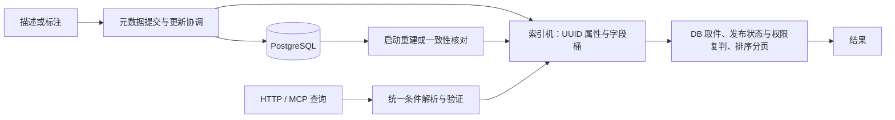

# 索引机维护与功能扩展研究

> 2026-10-08。基于当前代码审查、现有测试及临时行为探针。本文是实施建议，生产代码尚未修改。

## 1. 结论与边界

索引机只有 5 个生产 Go 文件、2 个测试文件，无第三方依赖。难维护的主要原因是更新契约和查询语义跨组件分散，不是目录数量不足。建议沿用管理机本轮的方式：单包按职责分文件，只抽取真实共享的逻辑。

保留：DB 是元数据事实源；indexer 是进程内、可重建的派生状态；输入属性或表达式，输出 UUID；不调用管理机、repo、HTTP，不自行扫描文件或启动维护任务。DB 加载、更新协调、权限与发布状态复判、运维入口属于编排/装配层。



## 2. 当前代码与验证

|职责|落点|
|---|---|
|接口、操作符、桶类型、统计、目录|`indexer-go/indexer.go`|
|表达式树及纯 And 展平|`indexer-go/expr.go`|
|锁、属性镜像、更新、重建、集合运算、扫描|`indexer-go/mem.go`|
|枚举/多值/数值桶、归一化|`indexer-go/bucket.go`|
|查询选择、降级、取件、排序、DB 分页重建|`mcp-server-go/core/search.go`|
|JSON 条件解析|`mcp-server-go/internal/search/conditions.go`|
|字段含义与基准|`mcp-server-go/internal/search/bench.go`、`guide.go`、两份字段/检索文档|
|启动装配|`mcp-server-go/cmd/server/main.go`|
|更新来源|`core/executor.go`、`describe.go`、`delete.go`、`manager-go/updater.go`|

本轮通过：indexer `go test ./... -count=1`、`go vet ./...`；后端 `go test ./core/... ./internal/search/... -count=1`。未启动后端和数据库，未重跑历史 E2E，未运行 race 检测。现有并发测试是单写者、多读者，不能证明多个更新来源的业务顺序正确。

临时探针位于系统临时目录，不属于生产代码；只验证公开接口的行为。索引机阅读地图见同目录 `structure.html`，扫描范围仅 `indexer-go`，共 7 个文件。

## 3. 优先修复的实际问题

### 3.1 索引没有就绪状态（代码审查确认）

`main.go:77` 创建并注入非 nil 索引，`main.go:117` 重建失败仅记录日志。`core/search.go:37` 只检查是否 nil；空命中在 `:195` 直接作为正常结果返回。因此重建失败后并不会按启动日志的承诺自动 SQL 回退；后续增量还可能形成只有部分文件的索引。

建议由编排层维护 `uninitialized/ready/degraded` 状态及重建结果。只有一次完整成功重建才能确立全集完整性；增量写入不能把失败的索引变成 ready。区分“可服务但过期”和“全集不完整”，影响 Not/exists=false 等操作的准确性。

### 3.2 查询降级可能改变条件（代码审查确认）

- `core/search.go:198-201` 批量取件失败后直接 `Fallback.Search(ctx,q)`。`SearchByConditions` 的 expr 不在 q.Attributes 中，原布尔表达式可能丢失。高级表达式在这种故障下应返回错误；等价 SQL 支持完成后才能降级。
- `degradeExpr` 把同字段多条件写进 map，后面的覆盖前面的。例如 `k=a AND k=b` 不能转换成只留下 `k=b`。
- 索引 `in` 是任一值命中，repo `metaWhere` 使用 `attributes @> JSON`。数组包含要求包含所有指定元素，标量也不会因 JSON 数组而按候选集合匹配。multi 的 eq 元素命中与 JSON 标量包含同样不能直接等同。
- SQLSearcher 不传递 OrderBy/Order，属性排序请求降级后也不保证原排序。

建议建立显式的“能否等价执行”判定。短期只降级已经证明等价的查询，其他返回明确错误；长期让 SQL 条件编译器消费相同 Expr。禁止靠把表达式压成 map 近似执行。

### 3.3 Update 依赖调用者提供准确 old（探针复现）

`mem.go:265-282` 用调用者 old 卸载桶，再覆盖 attrs 镜像。

复现：先 A，再 A→B，再收到 old=A/new=C；B 没有被卸载。按当前 C 删除文件后，B 仍能查出 UUID，而 attrs 已没有该文件。RWMutex 只能保护 map，不能解决业务旧值过期或多个更新来源交错。

建议：索引使用自身保存的现态做 diff，并深拷贝输入。可先保留 Update(old,new) 兼容签名，将 old 作为诊断信息，逐步改为明确的 Replace/Remove 契约。这个修复可以避免多值残留，但不能判断 new 是否来自过期提交。

后续需要元数据专用递增 revision，DB 提交返回 revision；索引按 UUID 接收完整属性快照和 revision，拒绝旧 revision，删除也带 revision。不要直接使用 updated_at 作严格顺序号，下载计数也会刷新它；分析家族 ver 是算法版本，也不是文件提交顺序。UUID 同步协调应覆盖 DB 提交与索引发布，避免两者顺序反转；DB 属性读改写本身的丢更新需另行用事务/CAS 解决。

### 3.4 输入引用泄漏（探针复现）

`mem.go:282`、`:299` 保存传入 map 引用。挂载 k=A 后，调用者将 map 改成 k=B：eq A 仍命中，contains B 也命中。嵌套数组和对象同样需要隔离；浅拷贝外层 map 不足。明确索引拥有快照，不依赖调用者终身保持不可变。

### 3.5 类型取决于首次数据（探针复现）

`mem.go:305-319` 按首值建桶；scalar="a" 与 array=["a"] 同字段时，先到哪种类型就只有哪种文档被 eq 查到。Rebuild 遍历 map 无稳定顺序，混型数据重建后可能改变桶型和结果。

建议稳定字段声明类型与支持的 op；自由 sp-* 字段保持发现能力，但发生类型冲突要报告，不静默丢弃。需要明确混型策略，不能通过排序输入来掩盖语义问题。现有 bench 注册表只有描述/基准，不能直接作为完备类型表。类型定义应位于无 IO 的字段契约位置，运行时查询验证与前端操作符目录由同一份定义导出，避免在每个层另写一份 switch。

其他边界：enum 将 bool true 和字符串 "true"、数字 3 和字符串 "3" 合并为同一键，而 ne 的 sameValue 不完全遵循此规则；float32 被视为可索引但 keyOf 不支持；非有限浮点会破坏数值桶排序，int64→float64 有精度范围。这些要作为值规范的统一取舍验证。

### 3.6 空属性文档不属于全集（探针复现）

Rebuild 仅在 len(attrs)>0 时保存 UUID；Update 空 map 等同删除。因此没有属性的有效文件无法被 exists=false 或 Not 查出。要区分文档存在性与可索引属性：Replace(uuid,{}) 保留文档，Remove(uuid) 才移除。全集由全部已发布、未软删的有效 UUID 定义。

### 3.7 发布状态规则需要与管理机对齐（代码审查确认）

`repo.listMetadataPage` 已过滤入库 reserved、移动 pending，重建口径正确；`GetMetadataByUUIDs` 不过滤 pending，`collectByUUIDs` 只排除 IsDeleted，并没有重新验证属性表达式。SQL 搜索 metaWhere 也没有 pending 排除条件。现有索引 UUID 在移动 pending 期间可能仍被搜索返回。

建议索引结果只作候选集，取件后复判软删、发布状态、权限及当前属性。复判可以排除陈旧误命中，不能修复索引漏掉的候选，因此仍要处理同步完整性和对账。管理机的文件读接口拒绝 pending，不代表搜索列表自动获得相同语义。

## 4. 未来功能如何安排职责

|新增能力|主要维护位置|需要共同验证的内容|
|---|---|---|
|普通数值/字符串/数组字段|描述机提取器 + 字段契约 + bench|增量/重建一致，目录类型、op 正确，版本回填|
|新比较操作符|索引表达式验证与执行 + SQL 能力判定|缺键、null、空数组、类型错误、HTTP/MCP 同口径|
|日期、精确大整数、对象子字段|值规范与专用桶|精度、时区、路径解释、历史数据迁移|
|排序、Top-N、分页|编排查询门面；性能证据成立后下推|权限过滤前不能截断候选，同值稳定排序、降级同义|
|标签全包含|独立 all/in-all 语义或多个 eq 的 And|不能把当前任一命中 in 改成全部命中|
|全文或向量检索|专门后端及编排候选组合|原文字段、相似度/排名、可见性、过滤组合|
|目录/归属/权限变化|repo/编排复判|UUID 不变时哪些字段需重分析，目录规则变化不塞进桶|
|在线重建|编排维护流程 + 索引批量构建/切换|快照、期间更新、失败保留旧索引、内存峰值|
|多进程部署|持久变更记录或统一索引后端|各进程不漏更新、提交顺序、恢复游标|

增加普通标量字段不应改桶算法。新值结构或新查询语义才需要改索引内核。保留人工字段文档，但机器类型、可用 op、前端选项尽量从契约导出；文档和例子用一致性检查约束。

## 5. 结构整理建议

在修复一致性时逐步整理，继续单包：

```text
indexer-go/
  indexer.go       对外接口和类型
  expr.go          表达式模型
  validate.go      表达式形状、类型、深度与节点预算
  mem.go           实例状态与锁
  update.go        快照替换、移除、revision、重建
  query.go         求值、交并补集
  scan.go          ne/exists/contains
  bucket.go        桶契约与公共 keyed 操作
  bucket_num.go    数值桶（复杂度增长时再拆 enum/multi）
  value.go         深拷贝、类型与归一化
  catalog.go       字段目录与统计
  README.md        不变量、新增功能步骤、排障方法
```

这不是必须一次创建的文件清单：只在对应职责实际变化时拆。enum/multi 已共享 queryKeyed、keyedStats、keyedValues，无需再建 common 包。core/search.go 可按“检索执行/排序/重建维护”分文件，但保留同一 core 包；indexer 不导入 core。

## 6. 运维与恢复

最小状态：ready、文档数、字段/键/挂载数、最近完整重建时间与耗时、失败原因、类型冲突/跳过计数、查询耗时和降级原因。现有 Stats 只有 fields/keys/mounts，不能判断是否完整。内存测量需单独约定估计或实际采样，不能把挂载数当字节数。

增加只读一致性核对：DB 与索引的有效 UUID/属性 revision 差异，列出缺失、多余、过期。运行中的核对要使用快照或注明水位，不能把正在发生的更新都判成错误。修复按 UUID 重读当前 DB 状态再替换；不要拿旧核对报告直接写回。

当前仅启动重建在 HTTP 服务与异步队列启动前执行，进程内部没有启动并发窗口。现有 RebuildIndex 不适合直接公开在线调用：分页按可移动 file_path，多页无一致快照；加载期间变更和 Update 可能被最终 Rebuild 覆盖。在线重建先选择短时维护协调，或一致 DB 快照 + 持久变更重放；在旁边建新索引后切换只能解决查询停顿，不能独自解决漏更新。

## 7. 性能边界

- numBucket 插入移动切片 O(n)，逐行重建最坏 O(n²)。先基准测量，批量重建按字段收集后一次排序优于盲目换 B-tree。
- ne/exists/contains 每叶全库扫描，持读锁；复杂表达式会多次扫描。先加节点、深度、结果预算与取消能力，再按候选集优化。
- And 当前先计算所有子结果，再从最小集合做交集；并非提前选最便宜条件执行。
- Catalog 先全量枚举和排序所有值，最后截 50；响应有上限但计算无同等上限。高基数字段需受限采样/分页或维护摘要。
- 索引返回全部 UUID，编排取全部元数据后排序分页；size=1 不代表只读一条。Top-N 下推必须处理发布状态与权限复判，不能简单先截 N。
- 属性镜像含不可索引对象；深拷贝后要测内存预算。数字桶、扫描和重建都应有可重复的 1万/10万级基准，阈值基于本机数据决定。

## 8. 建议实施顺序与验收

1. **第一批：查询正确性。** readiness；取件失败保持原条件；限制非等价降级；pending 口径；同字段多条件不丢失。验证重建失败、eq/in 数组和标量、范围查询取件失败、OrderBy 降级。
2. **第二批：索引自身不变量。** 使用内部现态 diff、深拷贝、显式 Remove/空属性文档、类型冲突策略。用本轮探针场景做回归，并验证 Rebuild 与增量同终态。
3. **第三批：更新顺序。** 专用 revision、统一提交/发布协调，核对管理机和编排所有更新入口；解决 DB 读改写丢更新。验证并发描述/分析、乱序发布、删除后旧更新。
4. **第四批：维护能力与职责整理。** 状态/核对报告/显式重建入口、README、按实际变化拆文件；同步查询契约与机器目录。
5. **第五批：容量和新能力。** 基准后优化批量构建、目录、扫描、分页；有实际需要再加入全文/向量/外部服务。

必要测试不是堆同构断言：以直接扫描有效文档为语义参考，生成更新序列，比较桶查询、增量终态、重建终态；检查类型冲突插入顺序不改变结果、输入修改不影响快照。集成验证 DB 提交与索引发布顺序、重建故障、pending 和软删、权限过滤、条件降级；race 检测只证明内存访问保护，不能替代业务顺序验收。

本轮没有实施上述生产改动，也没有提交本研究文档。
